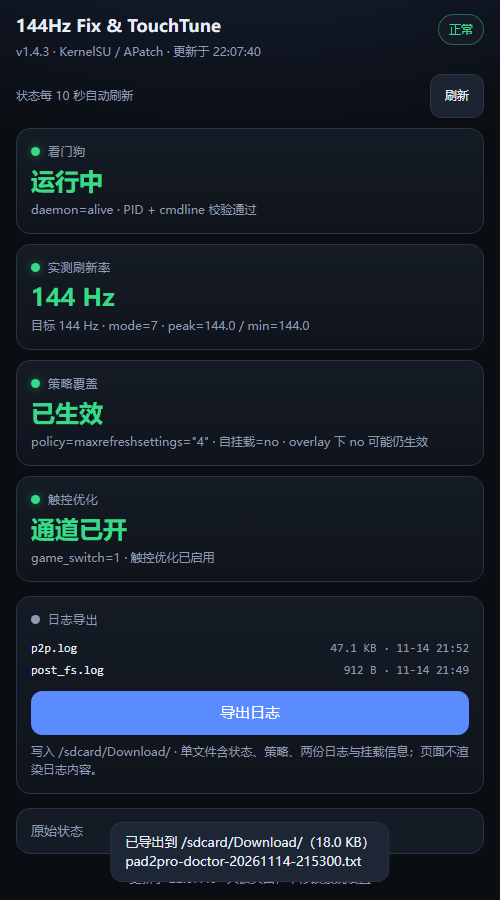

# Pad 2 Pro 144Hz Fix & TouchTune (OPD2413)

一加 Pad 2 Pro 专用模块（KSU / APatch / Magisk 均可）：修复「卡在 120Hz 上不去 144」，上限放到 144Hz 且系统仍可切换；附带触控优化。

## 它修的是什么（真机探针 + 实测）

根因有两个：

1. ColorOS 策略文件 `/my_product/etc/refresh_rate_config.xml` 尾部 `maxrefreshsettings="3"` 把刷新率截断在 120。
2. `min_refresh_rate=peak=144` 会让系统判定「固定刷新率」（`mRefreshRateChangeable=false`），亮屏后停在 120 不再切换。

解法：策略副本改 `4`（=144）交元模块合并 + `peak=144`/`min=120`（保持 `max-min>1`）+ 退避看门狗；设置页选「智能切换」。面板档位（CSOT 3392x2400）：30/48/50/60/90/120/144，144 就是内核默认档（id 7）。`service call SurfaceFlinger 1035` 强切实测为空操作，仅留实验开关。

## 做了什么（v1.6.2）

**刷新率**

- **策略源头覆盖**：副本生成到 `<模块>/my_product/etc/`，标准模块目录布局，**由元模块合并生效，本模块不自挂载**；每次开机从当前系统原件重生成（OTA 自适应）。副本补 `defaultMaxRate="144"` 与每个 `<item>` 的 `enableWinOverride="false"`，校验通过才落盘；`status` 的 `policy_complete=1` 才算策略生效。
- 没装元模块 / 元模块不接管 `my_product` 时，自动退化为纯运行时方案（下面几条仍保 144，只是设置页的智能降帧等策略行为不变）。
- **settings 写入**：`peak=144.0`、`min=120.0`、`user_refresh_rate=144`、`oplus_customize_screen_refresh_rate=4`、user-preferred display mode，开机/once 写一次；走 `setting_put` 三级回退 + 回读校验，失败记日志而不是假装成功。
- **看门狗（退避）**：亮屏稳态每 10s 查实测帧率；漂移时重写 min/peak 触发系统重新 modeset，2s 复查；连续失败退避 10→20→40→60s 封顶，成功回稳态；同因日志每分钟最多一条；灭屏 20s 长睡。

**触控**

- **持久档位 `sensitive_level=2` / `smooth_level=3`**：这两个节点是固件抗抖/平滑参数（raw 15/96），远灵敏于出厂 255/255 但保留抗抖与路径平滑，缓解 FPS 准星微抖（4/1 下的单边手感反馈；2/3 vs 4/1 受控 A/B 待做）。追求最跟手（绘图向）可改 4/1（raw 10/32，FPS 易微抖）。
- **独立守护 `apply.sh guard`**：ColorOS 会把档位改回 0（真机实测只写一次保不住），守护亮屏每 1s 检查、回退即写回并回读，每分钟最多 `TOUCH_GUARD_MAX_WRITES`（默认 6）次防拉锯，灭屏不写；与刷新看门狗分进程、互不拖累。守护只写 proc，不写 `touch_scene_para`。
- **`game_switch_enable=1`（高触控轮询率）**：开机写一次 + 守护维护。系统侧这是「高触控轮询率（HighTouchPollingRate）」的唯一用户态入口（固件 GAME_ON）；面板规格上限 540Hz、默认 120Hz，但内核没有速率旋钮。**用户真机观察（2026-11-18）：报点率≈2×显示刷新率（144Hz 显示→≈288Hz），540Hz 仅 90Hz 显示档可达——与保 144 显示互斥**；gs=0/1 两态差异用 `tools/touch_rate.sh` 受控实测确认。想完全不碰设 `TOUCH_GAME_SWITCH="-1"`。依据见 [docs/touch-research-v1.5.md](docs/touch-research-v1.5.md) 与 [docs/touch-rate-540-design.md](docs/touch-rate-540-design.md)。
- **触控 IRQ 自动绑最强 CPU 簇**（policy6，max 3.28GHz）：动态解析 `/proc/interrupts`（编号每次开机都变），匹配关键字 `touch`；实测默认中断全砸 CPU0 小核。
- 内核自带 `touch_boost_cpufreq`（触摸时 CPU 提频）保持原样；格式未知的 boost 节点只记录不盲写。

**WebUI**：模块卡直接打开，「实测刷新率」「触控档位」两卡 + 一行「看门狗 · 策略」小字；一键导出日志 / 复制状态；只读、不渲染日志内容；日志每次重启自动清空。

**安全设计**

- 首次运行自动备份原始值到 `/data/adb/p2p144/backup.conf`（settings 四键 + 档位）。
- 卸载自动还原 + 清 user-preferred mode；兼容旧版 game_switch 备份行、umount 历史自挂载残留。
- 安装时校验机型（非 OPD2413 拒装）。
- 日志每次重启清空（只含本次开机），运行中超 100KB 自动截断兜底。

## 安装

KSU / APatch 管理器 → 模块 → 从存储安装 → 选 zip → 重启；Magisk 用「从本地安装」。

**前提（可选但推荐）**：装有接管 `my_product` 的挂载元模块（meta-overlayfs / Hybrid Mount / Magic Mount-rs 需 `extra_mount=["my_product"]` 等）。没有也能用——自动退化为纯运行时方案，仍保 144。

## 用法

- 看状态：模块卡点「WebUI」或「操作」，或 `sh /data/adb/modules/pad2pro_144_touch/apply.sh status`
- 立即应用：同目录 `apply.sh once`
- 调整行为：编辑模块目录下 `config.conf`（**注释即详细说明**），改完重启或点「操作」；`POLICY_*` 必须重启。

| 键 | 默认 | 作用 |
|---|---|---|
| `REFRESH_PEAK` | `144.0` | `peak_refresh_rate` |
| `REFRESH_MIN` | `120.0` | `min_refresh_rate`；保持 `peak-min>1`，**不要用 144.0**（会固定刷新率卡 120）；`10.0`=允许闲时降帧省电 |
| `USER_REFRESH_RATE` | `144` | secure `user_refresh_rate` |
| `OPLUS_REFRESH_KEY` | `4` | secure `oplus_customize_screen_refresh_rate`（144 档=4） |
| `SF_FALLBACK_ID` | `6` | SF 1035 解析不到目标 mode id 的兜底 |
| `SF_1035_ENABLE` | `0` | SF 1035 实验强切；本机实测空操作，默认关 |
| `TOUCH_SENSITIVE_LEVEL` | `2` | 抗抖档 0-5，越小越灵敏（2=raw15 均衡，4=raw10 高灵敏，0=出厂）；`-1`=不碰 |
| `TOUCH_SMOOTH_LEVEL` | `3` | 平滑档 0-5，越大越平滑（3=raw96，1=raw32，0=出厂）；`-1`=不碰 |
| `TOUCH_GAME_SWITCH` | `1` | `game_switch_enable`（高轮询率）；`-1`=不碰，`0`=强制关；系统改回时守护写回 |
| `TOUCH_IRQ_AFFINITY` | `auto` | IRQ 绑最强 CPU 簇；`0`=关；或 CPU 列表如 `"6 7"` |
| `TOUCH_GUARD` | `pin` | 触控守护：`pin`=回退即写回 / `log`=只记录（排查用）/ `off`=关 |
| `TOUCH_GUARD_INTERVAL` | `1` | 守护亮屏巡检秒（灭屏自动 5s） |
| `TOUCH_GUARD_MAX_WRITES` | `6` | 每分钟写回上限，超过退避到下一分钟 |
| `TOUCH_GUARD_DEFER_MAX` | `10` | 报点活跃（触摸 IRQ 计数增长）时连续暂缓写回的 tick 数，达到后强制写一次 |
| `WATCH_INTERVAL` | `10` | 看门狗稳态巡检秒（灭屏 20s，失败退避至 60s 封顶） |
| `TARGET_HZ` | `144` | 目标实测帧率（也用于 SF mode id 解析） |
| `POLICY_ENABLE` | `1` | `1`=生成策略副本；`0`=纯运行时方案（改完重启） |
| `POLICY_RATE` | `4` | 策略目标档（4=144） |
| `POLICY_DEFAULT_MAX_RATE` | `144` | `<config defaultMaxRate>`（Hz 值；空=不写） |
| `POLICY_WIN_OVERRIDE` | `all` | `all`=所有 `<item>` 加 `enableWinOverride="false"`；`off`=不改 |

旧 config 残留的已移除键（`POLICY_MOUNT`/`FORCE_SF_MODE`/`FORCE_USER_MODE` 等）会被忽略，无害。

## WebUI（KernelSU / APatch）

安装/更新后**重启一次**，模块卡片出现 **WebUI** 入口（管理器用 WebView 打开，无需端口或额外服务）；守护约 10 秒启动，状态页点「刷新」即可。



- **状态页**：两卡 + 一行小字，每 10s 静默自动刷新。刷新率卡在固定模式且卡 120 时提示去设置选「智能切换」；触控卡按目标 vs 实际判定，档位被改回 0 时显示「目标 2 / 3 · 守护写回中 · 已写回 N 次」。
- **导出日志**：状态 + 策略摘要 + 两份日志各尾部 200 行 → `/sdcard/Download/pad2pro-doctor-<时间>.txt`；Download 不可写时回退 `/data/local/tmp/`，toast 报实际路径。**复制状态**：完整 `key=value` 进剪贴板（页面不展示原文）。
- **只读**：不改配置、不触发应用；要立即应用点模块卡「操作」。每个按钮都有 toast，自动刷新不打扰。
- 普通浏览器打开只显示提示页；Magisk 原生没有模块 WebUI，用「操作」按钮或命令行。

## 挂载与元模块

元模块（metamodule）是 KSU 的挂载基础设施（`module.prop` 带 `metamodule=1`，如 meta-overlayfs / Hybrid Mount / Magic Mount-rs / Mountify），同一时间只能装一个；**没装元模块，所有普通模块都不会被挂载**（[KSU 官方文档](https://kernelsu.org/guide/metamodule.md)）。

- 本模块副本走标准模块目录，任何支持分区目录的元模块都能识别，无需为某个元模块写规则。
- 有些元模块默认不接管 `my_product`（Magic Mount-rs 要 `extra_mount=["my_product"]`）——去配它，或接受退化：`policy_source=runtime-only` 时 peak/min + 看门狗仍保 144，WebUI 显示中性「运行时方案」而非异常。
- 其他模块（如 extreme_gt）可能 bind 同一策略文件叠在最上层，属正常竞争——本模块只看活文件结果（`policy=maxrefreshsettings="4"` 即达标），不区分来源、不对抗。
- 排查：`policy_module`（副本内容）=4 而 `policy=3` → 没有外部接管；都=3 → 副本没生成对（看 `post_fs.log`）。`policy_bind` 恒为 `no`（历史兼容）。
- 关 `POLICY_ENABLE` 后，若元模块已先合并旧副本，它可能撑完这一轮开机：重启两次，或先删模块下 `my_product/` 再重启。

## tools/ 诊断脚本（不参与安装，仅排查用）

- `check_v12.sh`：一键体检（144 状态/策略 diff/挂载归因）→ `/sdcard/Download/p2p_v12_check.txt`
- `touch_rate.sh`：只读实测触控报点率（统计触摸 IRQ 计数差，需手指持续滑动）；120/240/288/540Hz 分别≈8.3/4.2/3.5/1.9ms 一帧（288=2×144 显示；540 仅 90Hz 显示档）
- `probe_oplus.sh`：只读探针（显示/触控接口枚举）→ `/sdcard/Download/pad2pro_probe.txt`
- `archive/tune_144.sh`：一次性实验存档，结论已并入 `apply.sh`，平时不用跑

## 已知取舍

- `min=144` 会固定刷新率卡 120，**不要用**；30fps 视频抖动可把 `REFRESH_MIN` 改 `"10.0"`。设置页「高刷新率」也可能写成 144/144，卡 120 请选「智能切换」。
- 策略覆盖把所有 app 的「自动/高刷」档强制到 144：视频类 app 的智能降帧失效（功耗略增）；只想放开上限不强制，设 `POLICY_ENABLE="0"`（重启）。
- 守护会与系统「抢」档位（≤1s 写回、每分钟 ≤6 次）；日志反复出现「回退持续, 已达上限」说明有程序在持续改档，先切 `TOUCH_GUARD=log` 跑一个周期定位。
- `game_switch` 可能与游戏助手互写（本机写它只发固件 GAME_ON，不联动档位）；`p2p.log` 里回退频繁就设 `TOUCH_GAME_SWITCH="-1"`。
- **每次写触控 proc 节点报点停 ≥20ms**（固件命令持锁 `msleep(20)`+重试，报点线程同一把锁）。守护写回前用触摸 IRQ 计数差值避让报点活动（`fd_touch_count` 受 `face_detect_support` 门控本机不存在）；连续避让 `TOUCH_GUARD_DEFER_MAX`（默认 10）tick 后强制写一次。偶发跳帧先看 `touch_fallback` 是否在涨、日志有无「强制写回」，再考虑 `TOUCH_GUARD=log`。
- **540Hz 没有可挂载的触控配置文件**：内核场景通道只认 5 个键、无速率键，只能 `game_switch_enable=1` + 实测；社区 hbp/node-182 模块属别的触控栈，**照抄会断触**。用户真机观察报点≈2×显示刷新率、540Hz 仅 90Hz 显示档可达——「144 显示 + 540 触控」本机互斥，144 下现实上限≈288Hz。完整调研见 [docs/touch-rate-540-design.md](docs/touch-rate-540-design.md)。
- 策略是否真生效看 `policy_complete=1`；重启后仍=0 说明副本没成为活文件（看 `policy_live_src`），只能靠运行时层。
- 本机 ksu 域直接 `settings`/`cmd`/`input` 会被 system_server 拒绝（Failed transaction）；模块已加回退 + 回读，失败记日志，真机改设置以系统设置页为准。
- 充电插拔切厂商 charging 表（同档略保守）、游戏助手进游戏改档，都接受不对抗。
- 手写笔管线刻意不碰：`ipePencilRateId="3"` 与 `pen_sensitive_level` 保留。
- 触控手感只改 `TOUCH_SENSITIVE_LEVEL`/`TOUCH_SMOOTH_LEVEL`（0=厂商默认，`-1`=不碰），不用改代码；档位方向与一手依据见 [docs/touch-research-v1.5.md](docs/touch-research-v1.5.md)。
- WebUI 刻意只读：改配置编辑 `config.conf`，避免网页把引号/注释改坏。

## 验证

```
adb shell su -c "sh /data/adb/modules/pad2pro_144_touch/apply.sh status"
adb shell su -c "dumpsys display | grep -E 'mActiveModeId|mActiveRenderFrameRate'"
```

期望：`mActiveModeId=7`、render≈144.x、`refresh_changeable=true`、`peak=144.0`；`min`=120.0 或「智能切换」当前值（ksu 域写不进时只要 `refresh_changeable=true` 不影响 144）。有外部接管时 `policy=4` 且 `policy_complete=1`；无接管时 `policy_source=runtime-only` 且 render 仍 144。`refresh_changeable=false` 且 render=120 → 设置选「智能切换」。
WebUI：状态页应显示「正常」；「导出日志」应在 `/sdcard/Download/` 出现 `pad2pro-doctor-<时间>.txt`。完整真机验收清单见 [docs/agent-notes.md](docs/agent-notes.md)。

## 改代码

先读 [AGENTS.md](AGENTS.md)：执行顺序、必守约定与分支笔记入口（踩坑证据在 [docs/agent-notes.md](docs/agent-notes.md)）。触控接口一手源码依据见 [docs/touch-research-v1.5.md](docs/touch-research-v1.5.md)。
